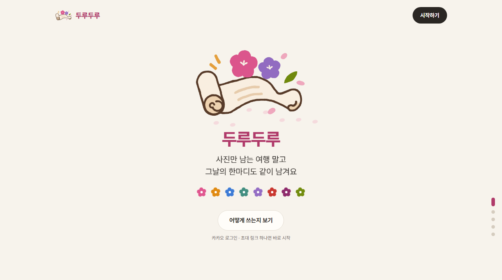
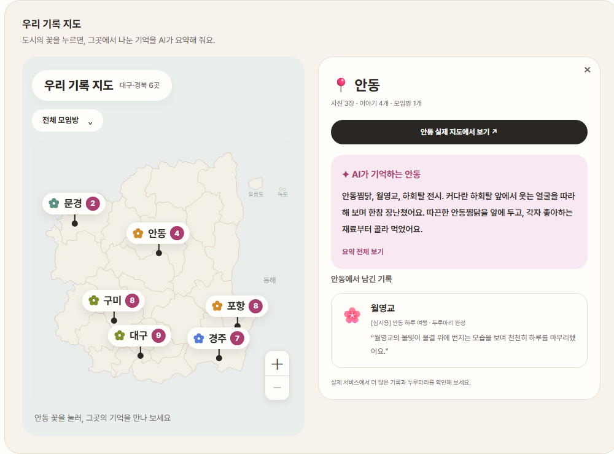
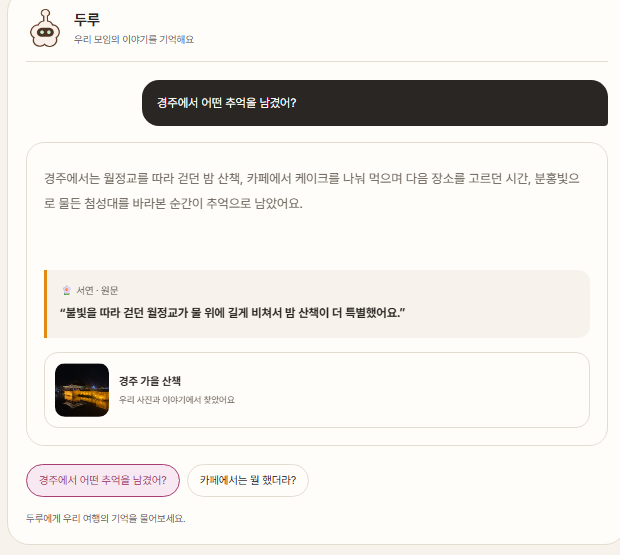
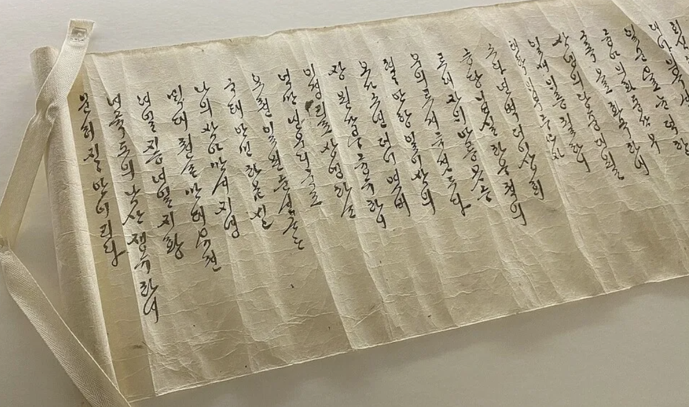

<p align="center">
  
</p>

# 두루두루 · Duruduru

> 사진에 한마디씩, 그날의 이야기를 엮어요.

**2026 단디톤 · 단디메이트**

두루두루는 함께한 여행 사진에 각자의 기억을 더하고, AI가 모인 이야기를 하나의 **두루마리**로 엮어 주는 서비스입니다. 길게 글을 쓰지 않아도, 사진에 떠오르는 한마디를 말이나 글로 남기는 데서 시작합니다.

이 저장소는 서비스 소개, 화면 시연, 체험 안내를 제공하는 정적 랜딩 페이지입니다.

| 바로가기 | 주소 |
| --- | --- |
| 서비스 소개 페이지 | [duruduru-landing.vercel.app](https://duruduru-landing.vercel.app/) |
| 실제 서비스 | [43-201-73-60.sslip.io](https://43-201-73-60.sslip.io/) |
| GitHub 저장소 | [Dandimate-2026/duruduru-landing](https://github.com/Dandimate-2026/duruduru-landing) |



## 사진은 나눴는데, 그날의 이야기는 어디에 있을까요?

여행을 다녀오면 각자 찍은 사진을 단톡방에 올립니다. 사진은 쌓이지만, 그곳에서 나눈 대화와 각자가 기억하는 순간까지 함께 남지는 않습니다.

두루두루는 사진을 **함께 기억을 꺼내는 계기**로 만듭니다. 같은 사진을 보고 서로의 이야기를 덧붙이고, AI가 그 목소리들을 엮어 다시 읽을 수 있는 여행 기록으로 남깁니다.

## 한마디가 두루마리가 되기까지

1. **사진에 첫 한마디** — 사진을 고른 이유와 떠오르는 기억을 말이나 글로 남깁니다.
2. **친구 사진 돌려보기** — 내 기억을 덧붙이고, 같은 순간을 바라본 친구의 이야기도 읽습니다.
3. **필요하면 AI가 되묻기** — 이야기를 읽은 AI가 필요한 기억을 질문으로 더 모읍니다.
4. **우리만의 두루마리 완성** — 사진과 각자의 이야기를 하나의 여행 기록으로 엮습니다.
5. **다시 읽고 간직하기** — 두루마리를 펼치고, 이야기가 잘 담겼는지 확인한 뒤 저장하고 공유합니다.

카카오 로그인과 초대 링크로 함께 시작하며, **1~8명**의 기억을 담습니다.

## 꽃을 누르면, 그곳의 기억이 열려요

**우리 기록 지도**는 도시마다 남긴 기록을 꽃으로 보여 줍니다. 도시의 꽃을 누르면 AI가 요약한 여행의 기억과 사진·원문을 함께 확인할 수 있습니다. 장소별 기록을 살펴보며 지난 여행을 다시 꺼내 봅니다.



**두루에게 물어보기**에서는 “경주에서 어떤 추억을 남겼어?”처럼 질문할 수 있습니다. 두루는 우리 기록에서 기억을 찾아 답하고, 답변의 근거가 된 이야기와 사진을 함께 보여 줍니다.

<p align="center">
  
</p>

## 함께 남기고, 다시 펼쳐 보는 기능

| 기능 | 경험 |
| --- | --- |
| 멤버별 꽃 | 모임방의 꽃을 눌러 나와 친구들이 남긴 사진과 이야기를 확인합니다. 꽃 옆 숫자는 사진과 이야기를 더한 활동 수입니다. |
| 지역 템플릿 | 경주·안동·대구·포항·영천 등 여행지의 풍경과 상징으로 두루마리를 꾸밉니다. |
| 끈 풀어 펼치기 | 기본 템플릿의 두루마리 끈을 풀고, 완성된 기록을 펼쳐 읽습니다. |
| 원문과 평가 | AI가 엮은 이야기를 원문과 비교하고, 내 기억이 잘 담겼는지 평가합니다. |
| 다시 엮기 | 방장이 다시 엮기를 요청하고, 바뀐 부분과 이전 버전을 확인합니다. |
| 저장과 공유 | 완성된 두루마리를 PNG·PDF·ZIP으로 간직하고, 링크로 친구들과 나눕니다. |

## 심사용 서비스 체험

1. [실제 서비스](https://43-201-73-60.sslip.io/)에 접속해 **카카오 로그인**을 진행합니다.
2. 내 모임방 화면에서 **심사용 데모**를 ON으로 켭니다.
3. **[심사용] 경주 가을 산책**, **[심사용] 포항 바다의 밤** 모임방에서 준비된 기록을 살펴봅니다.
4. 완성된 두루마리 목록에서 **[심사용] 안동 하루 여행**도 확인할 수 있습니다.

소개 페이지의 시작하기 버튼에서도 체험 안내를 볼 수 있으며, 확인 후 실제 서비스가 새 탭으로 열립니다.

랜딩의 지도·대화·평가·두루마리 펼치기는 준비된 기록으로 구성한 체험 예시입니다. 실제 기록 생성과 템플릿 적용, 저장·공유는 서비스에서 이용할 수 있습니다.

## 수백 년 전에도 우리는 기록으로 경험을 나눴습니다

> 함께 놀고 온다 → 길게 기록한다 → 돌려 읽는다.

경북 지역의 내방가사는 삶과 마음을 한글로 기록하고 필사와 낭독으로 나누던 문화입니다. 그중 **화전가(花煎歌)**에 담긴 봄날의 즐거움과 이야기에서 영감을 받았습니다.

두루두루는 함께 다녀온 여행의 사진에 한마디씩 더하고, 하나의 두루마리로 엮어 돌려 읽는 경험으로 이 방식을 이어 갑니다.

<p align="center">
  
</p>

관련 자료: [국립한글박물관, 「이내말삼 드러보소, 내방가사」 전시 소개](https://www.hangeul.go.kr/webzine/202201/sub1_3.html). 랜딩과 README의 내방가사 사진은 제공받은 자료를 사용했습니다.

## 저장소 구성

HTML·CSS·JavaScript로 구성되어 있으며, 별도 프레임워크나 빌드 단계 없이 정적 파일로 제공합니다.

```text
index.html               페이지 콘텐츠와 메타데이터
styles.css               반응형 레이아웃과 애니메이션
scripts/
  main.js                화면 전환과 기능 체험
  service-guide.js       서비스 진입 안내창과 새 탭 연결
assets/                  로고, 서비스 화면, 사진, SVG
  visuals/               HTML·CSS에서 분리한 공통 이미지
docs/images/             현재 랜딩을 촬영한 README용 화면
```

README의 소개·지도·대화 이미지는 현재 랜딩 페이지를 촬영한 화면입니다.
